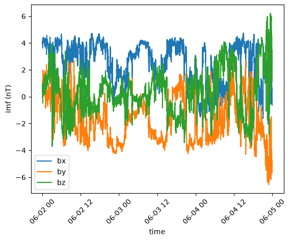
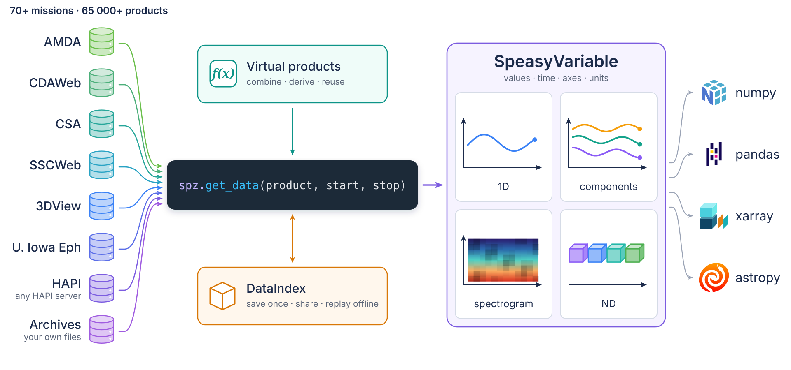
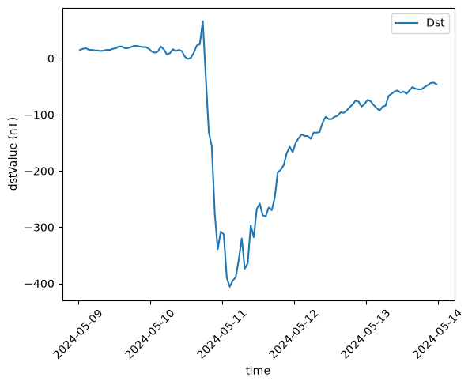
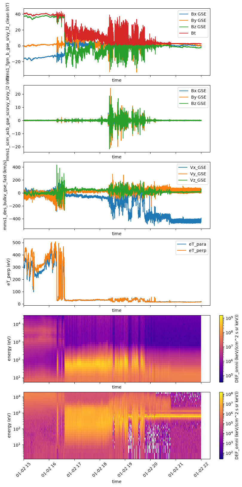
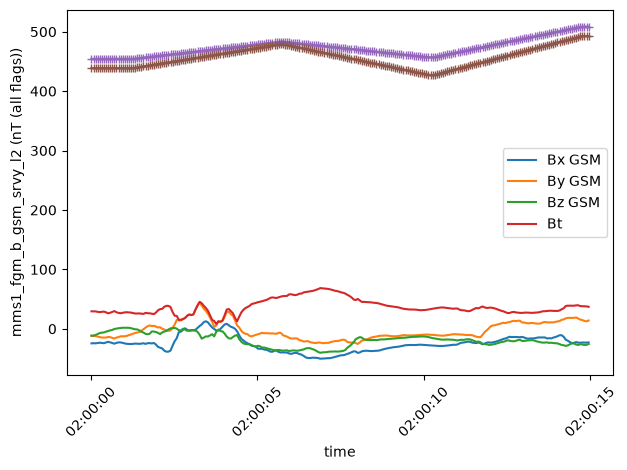
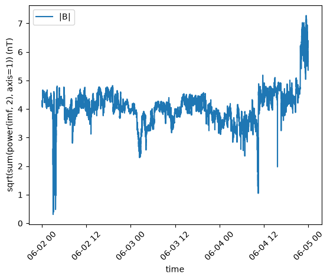

<h1 align="center">

</h1>

<p align="center"><b>Space Physics made EASY: one function for in-situ space physics data.</b></p>

<p align="center">
<a href="https://pypi.org/project/speasy"></a>
<a href="https://github.com/SciQLop/speasy/actions?query=workflow%3A%22Tests%22"></a>
<a href="https://speasy.readthedocs.io/en/latest/?badge=latest"></a>
<a href="https://doi.org/10.5281/zenodo.4118780"></a>
<a href="https://matrix.to/#/#speasy:matrix.org"></a>
<a href="https://mybinder.org/v2/gh/SciQLop/speasy/main?labpath=docs/examples"></a>
</p>

<!--[[[cog
# This file is the source: everything below between a cog marker comment and its matching end
# marker is generated by running `make readme` (cogapp, https://cog.readthedocs.io), which
# executes the Python shown in the visible fenced code blocks for real (live network calls to
# AMDA/CDA/SSC/HAPI) and writes its actual output back in place. Never hand-edit a generated region;
# edit the run("""...""") source strings below instead and regenerate. `make readme-check`
# verifies in CI that this file matches what regenerating it would produce.
import os
import tempfile
import matplotlib
matplotlib.use("Agg")
import matplotlib.pyplot as plt

README_IMG_DIR = os.path.abspath("README_files")
README_RAW_BASE_URL = "https://raw.githubusercontent.com/SciQLop/speasy/refs/heads/main"

def run(code):
    print(f"```python\n{code.strip()}\n```")
    exec(compile(code, "<readme>", "exec"), globals())

def run_in_tmp_dir(code):
    # Examples that create folders run in a throwaway directory, so `make readme` leaves no files behind.
    cwd = os.getcwd()
    with tempfile.TemporaryDirectory() as tmp:
        os.chdir(tmp)
        try:
            run(code)
        finally:
            os.chdir(cwd)

def save_and_show(name, alt):
    plt.savefig(os.path.join(README_IMG_DIR, name), bbox_inches="tight")
    plt.close("all")
    print(f"")
]]]-->
<!--[[[end]]]-->

<!--[[[cog
run("""
import speasy as spz
ace_mag = spz.get_data("amda/imf", "2016-6-2", "2016-6-5")
ace_mag.plot();
""")
save_and_show("ace_mag.png", "ACE interplanetary magnetic field")
]]]-->
```python
import speasy as spz
ace_mag = spz.get_data("amda/imf", "2016-6-2", "2016-6-5")
ace_mag.plot();
```

<!--[[[end]]]-->

That's it. Three lines, and you have three days of ACE magnetic field data, with time, units and labels.
The same call works for tens of thousands of products from many data centers.



## Why Speasy

- **One call for many archives.** [AMDA](https://amda.cdpp.eu/), [CDAWeb](https://cdaweb.gsfc.nasa.gov/),
  ESA's [Cluster Science Archive](https://csa.esac.esa.int/csa-web/), [SSCWeb](https://sscweb.gsfc.nasa.gov/),
  [CDPP 3DView](http://3dview.cdpp.eu/), the U. Iowa ephemeris tool, every server of the
  [HAPI](https://hapi-server.org/) server list, and your own archives described in a YAML file.
  See the [data providers page](https://speasy.readthedocs.io/en/latest/user/data_providers.html).
- **Find data by tab-completion.** Browse `spz.inventories.tree.<provider>` in IPython or Jupyter, down to each product.
- **Fast on the second request.** Data is cached on your disk, and a community cache server speeds up the first one.
- **Reproducible studies.** A [`DataIndex`](https://speasy.readthedocs.io/en/latest/user/data_index.html) keeps exactly
  the data a study used. It never expires, works offline, and exports as a single file to share with a colleague.
- **Fits the tools you already use.** Numpy functions work directly on Speasy variables, and they convert to
  pandas, xarray and astropy.
- **Your own products.** Register a Python function as a
  [virtual product](https://speasy.readthedocs.io/en/latest/user/virtual_products.html), and use it like any other product.
- **Also from the shell, and from Julia.** A [`speasy` command](https://speasy.readthedocs.io/en/latest/user/cli.html)
  downloads, converts and pre-fetches data. [Speasy.jl](https://github.com/SciQLop/Speasy.jl) brings the same API to Julia.

Prefer clicking to coding? [SciQLop](https://github.com/SciQLop/SciQLop) is a graphical interface built on Speasy.

## Installation

Speasy needs **Python 3.10 or newer**:

```console
$ python -m pip install speasy
```

Or try the command line without installing anything, with [uv](https://docs.astral.sh/uv/):

```console
$ uvx speasy get amda/imf 2018-06-01 2018-06-02
```

The first request for some data needs internet access; after that, it comes from the local cache.
Behind a proxy or a firewall? See the [configuration page](https://speasy.readthedocs.io/en/latest/user/configuration.html).

## Examples

### Browse instead of typing ids

Every provider is a tree you can explore with tab-completion. This is the same product as above:

<!--[[[cog
run("""
import speasy as spz
amda_tree = spz.inventories.data_tree.amda
ace_mag = spz.get_data(amda_tree.Parameters.ACE.MFI.ace_imf_all.imf, "2016-6-2", "2016-6-5")
""")
]]]-->
```python
import speasy as spz
amda_tree = spz.inventories.data_tree.amda
ace_mag = spz.get_data(amda_tree.Parameters.ACE.MFI.ace_imf_all.imf, "2016-6-2", "2016-6-5")
```
<!--[[[end]]]-->

### Any HAPI server

The Dst index during the May 2024 geomagnetic storm, from the World Data Center in Kyoto:

<!--[[[cog
run("""
import speasy as spz
dst = spz.get_data("hapi/wdc_kyoto_hapi/hour_dst/dstValue", "2024-05-09", "2024-05-14")
dst.plot();
""")
save_and_show("dst_may_2024.png", "Dst index, May 2024 storm")
]]]-->
```python
import speasy as spz
dst = spz.get_data("hapi/wdc_kyoto_hapi/hour_dst/dstValue", "2024-05-09", "2024-05-14")
dst.plot();
```

<!--[[[end]]]-->

### Several instruments on one figure

Magnetic field, electron and ion data from MMS1, on a shared time axis:

<!--[[[cog
run("""
import speasy as spz
import matplotlib.pyplot as plt

mms1 = spz.inventories.tree.cda.MMS.MMS1
fig = plt.figure(figsize=(8, 16), layout="constrained")
axes = fig.add_gridspec(6, hspace=0).subplots(sharex=True)

plots = [
    (mms1.FGM.MMS1_FGM_SRVY_L2.mms1_fgm_b_gse_srvy_l2_clean, axes[0]),
    (mms1.SCM.MMS1_SCM_SRVY_L2_SCSRVY.mms1_scm_acb_gse_scsrvy_srvy_l2, axes[1]),
    (mms1.DES.MMS1_FPI_FAST_L2_DES_MOMS.mms1_des_bulkv_gse_fast, axes[2]),
    (mms1.DES.MMS1_FPI_FAST_L2_DES_MOMS.mms1_des_temppara_fast, axes[3]),
    (mms1.DES.MMS1_FPI_FAST_L2_DES_MOMS.mms1_des_tempperp_fast, axes[3]),
    (mms1.DES.MMS1_FPI_FAST_L2_DES_MOMS.mms1_des_energyspectr_omni_fast, axes[4]),
    (mms1.DIS.MMS1_FPI_FAST_L2_DIS_MOMS.mms1_dis_energyspectr_omni_fast, axes[5]),
]

for product, ax in plots:
    spz.get_data(product, "2019-01-02T15", "2019-01-02T22").replace_fillval_by_nan().plot(ax=ax)
""")
save_and_show("mms1_multi_timeseries.png", "MMS1 multiple time series")
]]]-->
```python
import speasy as spz
import matplotlib.pyplot as plt

mms1 = spz.inventories.tree.cda.MMS.MMS1
fig = plt.figure(figsize=(8, 16), layout="constrained")
axes = fig.add_gridspec(6, hspace=0).subplots(sharex=True)

plots = [
    (mms1.FGM.MMS1_FGM_SRVY_L2.mms1_fgm_b_gse_srvy_l2_clean, axes[0]),
    (mms1.SCM.MMS1_SCM_SRVY_L2_SCSRVY.mms1_scm_acb_gse_scsrvy_srvy_l2, axes[1]),
    (mms1.DES.MMS1_FPI_FAST_L2_DES_MOMS.mms1_des_bulkv_gse_fast, axes[2]),
    (mms1.DES.MMS1_FPI_FAST_L2_DES_MOMS.mms1_des_temppara_fast, axes[3]),
    (mms1.DES.MMS1_FPI_FAST_L2_DES_MOMS.mms1_des_tempperp_fast, axes[3]),
    (mms1.DES.MMS1_FPI_FAST_L2_DES_MOMS.mms1_des_energyspectr_omni_fast, axes[4]),
    (mms1.DIS.MMS1_FPI_FAST_L2_DIS_MOMS.mms1_dis_energyspectr_omni_fast, axes[5]),
]

for product, ax in plots:
    spz.get_data(product, "2019-01-02T15", "2019-01-02T22").replace_fillval_by_nan().plot(ax=ax)
```

<!--[[[end]]]-->

### Many products, many intervals, one call

The result holds one list per product, with one variable per interval:

<!--[[[cog
run("""
import speasy as spz
products = [
    spz.inventories.tree.amda.Parameters.Wind.SWE.wnd_swe_kp.wnd_swe_vth,
    spz.inventories.tree.amda.Parameters.Wind.SWE.wnd_swe_kp.wnd_swe_pdyn,
    spz.inventories.tree.amda.Parameters.Wind.SWE.wnd_swe_kp.wnd_swe_n,
    spz.inventories.tree.cda.Wind.WIND.MFI.WI_H2_MFI.BGSE,
    spz.inventories.tree.ssc.Trajectories.wind,
]
intervals = [["2010-01-02", "2010-01-02T10"], ["2009-08-02", "2009-08-02T10"]]
data = spz.get_data(products, intervals)
""")
]]]-->
```python
import speasy as spz
products = [
    spz.inventories.tree.amda.Parameters.Wind.SWE.wnd_swe_kp.wnd_swe_vth,
    spz.inventories.tree.amda.Parameters.Wind.SWE.wnd_swe_kp.wnd_swe_pdyn,
    spz.inventories.tree.amda.Parameters.Wind.SWE.wnd_swe_kp.wnd_swe_n,
    spz.inventories.tree.cda.Wind.WIND.MFI.WI_H2_MFI.BGSE,
    spz.inventories.tree.ssc.Trajectories.wind,
]
intervals = [["2010-01-02", "2010-01-02T10"], ["2009-08-02", "2009-08-02T10"]]
data = spz.get_data(products, intervals)
```
<!--[[[end]]]-->

### Numpy works directly

Compute the field magnitude yourself, and check it against the one MMS provides:

<!--[[[cog
run("""
import speasy as spz
import numpy as np
mms1 = spz.inventories.tree.cda.MMS.MMS1
b = spz.get_data(mms1.FGM.MMS1_FGM_SRVY_L2.mms1_fgm_b_gsm_srvy_l2, "2017-01-01T02:00:00", "2017-01-01T02:00:15")
b.replace_fillval_by_nan(inplace=True)
bt = b["Bt"]
b = b["Bx GSM", "By GSM", "Bz GSM"]
computed_norm = np.sqrt(np.sum(b ** 2, axis=1))
print(f"Type of computed_norm: {type(computed_norm)}")
print("Same as the provided magnitude?", bool(np.allclose(computed_norm, bt)))
""")
]]]-->
```python
import speasy as spz
import numpy as np
mms1 = spz.inventories.tree.cda.MMS.MMS1
b = spz.get_data(mms1.FGM.MMS1_FGM_SRVY_L2.mms1_fgm_b_gsm_srvy_l2, "2017-01-01T02:00:00", "2017-01-01T02:00:15")
b.replace_fillval_by_nan(inplace=True)
bt = b["Bt"]
b = b["Bx GSM", "By GSM", "Bz GSM"]
computed_norm = np.sqrt(np.sum(b ** 2, axis=1))
print(f"Type of computed_norm: {type(computed_norm)}")
print("Same as the provided magnitude?", bool(np.allclose(computed_norm, bt)))
```
Type of computed_norm: <class 'speasy.products.variable.SpeasyVariable'>
Same as the provided magnitude? True
<!--[[[end]]]-->

### Convert to pandas, xarray or astropy

<!--[[[cog
run("""
import speasy as spz
ace_mag = spz.get_data("amda/imf", "2016-6-2", "2016-6-5")
print(type(ace_mag.to_dataframe()).__name__)
print(type(ace_mag.to_dataarray()).__name__)
print(type(ace_mag.to_astropy_table()).__name__)
""")
]]]-->
```python
import speasy as spz
ace_mag = spz.get_data("amda/imf", "2016-6-2", "2016-6-5")
print(type(ace_mag.to_dataframe()).__name__)
print(type(ace_mag.to_dataarray()).__name__)
print(type(ace_mag.to_astropy_table()).__name__)
```
DataFrame
DataArray
Table
<!--[[[end]]]-->

### Resample one product onto another

Interpolate ion temperatures onto the magnetic field timestamps:

<!--[[[cog
run("""
import speasy as spz
from speasy.signal.resampling import interpolate
import matplotlib.pyplot as plt
mms1 = spz.inventories.tree.cda.MMS.MMS1

b, Tperp, Tpara = spz.get_data(
    [
        mms1.FGM.MMS1_FGM_SRVY_L2.mms1_fgm_b_gsm_srvy_l2,
        mms1.DIS.MMS1_FPI_FAST_L2_DIS_MOMS.mms1_dis_tempperp_fast,
        mms1.DIS.MMS1_FPI_FAST_L2_DIS_MOMS.mms1_dis_temppara_fast,
    ],
    "2017-01-01T02:00:00",
    "2017-01-01T02:00:15",
)

Tperp_interp, Tpara_interp = interpolate(b, [Tperp, Tpara])

plt.figure()
ax = b.plot()
plt.plot(Tperp_interp.time, Tperp_interp.values, marker="+")
plt.plot(Tpara_interp.time, Tpara_interp.values, marker="+")
plt.tight_layout()
""")
save_and_show("resampling.png", "Resampling")
]]]-->
```python
import speasy as spz
from speasy.signal.resampling import interpolate
import matplotlib.pyplot as plt
mms1 = spz.inventories.tree.cda.MMS.MMS1

b, Tperp, Tpara = spz.get_data(
    [
        mms1.FGM.MMS1_FGM_SRVY_L2.mms1_fgm_b_gsm_srvy_l2,
        mms1.DIS.MMS1_FPI_FAST_L2_DIS_MOMS.mms1_dis_tempperp_fast,
        mms1.DIS.MMS1_FPI_FAST_L2_DIS_MOMS.mms1_dis_temppara_fast,
    ],
    "2017-01-01T02:00:00",
    "2017-01-01T02:00:15",
)

Tperp_interp, Tpara_interp = interpolate(b, [Tperp, Tpara])

plt.figure()
ax = b.plot()
plt.plot(Tperp_interp.time, Tperp_interp.values, marker="+")
plt.plot(Tpara_interp.time, Tpara_interp.values, marker="+")
plt.tight_layout()
```

<!--[[[end]]]-->

### Your own products

A virtual product is a Python function that Speasy serves like any other product:

<!--[[[cog
run("""
import numpy as np
import speasy as spz
from speasy.virtual_products import register_virtual_product

@register_virtual_product("virtual/ace/b_magnitude", meta={"units": "nT"}, labels=["|B|"])
def ace_b_magnitude(start, stop):
    b = spz.get_data("amda/imf", start, stop)
    return np.sqrt(np.sum(b ** 2, axis=1))

spz.get_data("virtual/ace/b_magnitude", "2016-6-2", "2016-6-5").plot();
""")
save_and_show("virtual_product.png", "ACE field magnitude, from a virtual product")
]]]-->
```python
import numpy as np
import speasy as spz
from speasy.virtual_products import register_virtual_product

@register_virtual_product("virtual/ace/b_magnitude", meta={"units": "nT"}, labels=["|B|"])
def ace_b_magnitude(start, stop):
    b = spz.get_data("amda/imf", start, stop)
    return np.sqrt(np.sum(b ** 2, axis=1))

spz.get_data("virtual/ace/b_magnitude", "2016-6-2", "2016-6-5").plot();
```

<!--[[[end]]]-->

### Keep a study's data

Inside a `DataIndex` block, `get_data` stores what it downloads in a folder.
Next time, the same calls are served from that folder, even offline.
Export it as one file, and a colleague gets exactly the same data:

<!--[[[cog
run_in_tmp_dir("""
import speasy as spz

with spz.DataIndex("my_study") as study:
    ace_mag = spz.get_data("amda/imf", "2016-6-2", "2016-6-5")  # downloaded, kept in my_study/
study.export_data("my_study.tar")                                # one file to send

# On your colleague's machine:
with spz.DataIndex("their_copy") as copy:
    copy.import_data("my_study.tar")
    ace_mag = spz.get_data("amda/imf", "2016-6-2", "2016-6-5")  # read from their_copy/, no download
""")
]]]-->
```python
import speasy as spz

with spz.DataIndex("my_study") as study:
    ace_mag = spz.get_data("amda/imf", "2016-6-2", "2016-6-5")  # downloaded, kept in my_study/
study.export_data("my_study.tar")                                # one file to send

# On your colleague's machine:
with spz.DataIndex("their_copy") as copy:
    copy.import_data("my_study.tar")
    ace_mag = spz.get_data("amda/imf", "2016-6-2", "2016-6-5")  # read from their_copy/, no download
```
<!--[[[end]]]-->

## Documentation

The [documentation](https://speasy.readthedocs.io/en/latest/) covers each data provider, configuration,
the command line, and has a gallery of [examples](https://speasy.readthedocs.io/en/latest/examples/index.html).
Speasy's plots are meant for quick looks; for publication figures, use Matplotlib directly,
or [SciQLop](https://github.com/SciQLop/SciQLop) for interactive exploration.

## Help us improve Speasy

- Tell us how you use Speasy in our [user survey](https://docs.google.com/forms/d/e/1FAIpQLScV12kvETk8jc4Zc4sIsHiteMHRVo5I8DiSAE8RyVdVkUaxJA/viewform?usp=sf_link).
- Report bugs or request features in the [issues](https://github.com/SciQLop/speasy/issues/new).
- Ask questions in the [discussions](https://github.com/SciQLop/speasy/discussions) or on [Matrix](https://matrix.to/#/#speasy:matrix.org).
- Want to add a data provider? See the [contributing guide](https://github.com/SciQLop/speasy/blob/main/CONTRIBUTING.rst).

## Citing Speasy

If Speasy helped your research, please cite it. GitHub's "Cite this repository" button, on the right of this page,
gives a ready-made reference from [CITATION.cff](CITATION.cff). Every release also has a
[Zenodo DOI](https://doi.org/10.5281/zenodo.4118780).

## Thanks

Speasy only exists thanks to the data centers and teams who produce, archive and serve the data,
and to the HAPI community for a shared standard.
The development of Speasy is supported by the [CDPP](http://www.cdpp.eu/).
