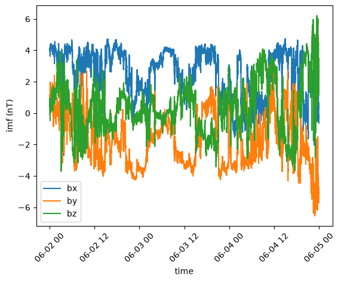
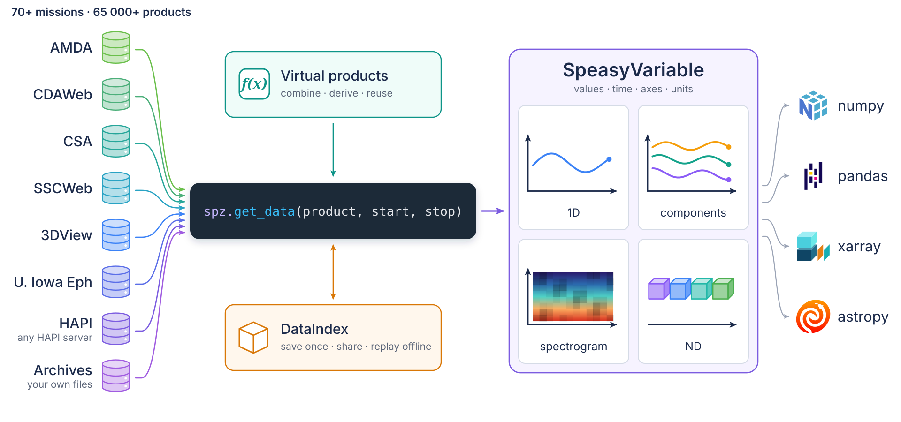

=======================
Space Physics made EASY
=======================

**One function for in-situ space physics data.**

Speasy fetches data from many space physics data centers with one call, and gives it back
in one consistent format, ready for numpy, pandas, xarray or astropy.

.. [[[cog
   # Everything between a cog marker comment and its matching end marker below is generated by
   # `make docs-quickstart` (cogapp, https://cog.readthedocs.io): it executes the Python shown in
   # each visible code-block for real (live network calls to AMDA) and writes the block plus,
   # where relevant, a real generated plot back in place. Never hand-edit a generated region; edit
   # the run("""...""") source strings below instead and regenerate. `make docs-quickstart-check`
   # verifies in CI that this file matches what regenerating it would produce.
   import os
   import cog
   import matplotlib
   matplotlib.use("Agg")
   import matplotlib.pyplot as plt

   def run(code):
       cog.outl(".. code-block:: python")
       cog.outl("")
       for line in code.strip().splitlines():
           cog.outl(f"    {line}")
       exec(compile(code, "<index.rst>", "exec"), globals())

   def show_image(name, alt, width="60%"):
       plt.savefig(os.path.join("_static", name), bbox_inches="tight")
       plt.close("all")
       cog.outl("")
       cog.outl(f".. image:: _static/{name}")
       cog.outl(f"   :width: {width}")
       cog.outl(f"   :alt: {alt}")

   run("""
   import speasy as spz
   ace_mag = spz.get_data("amda/imf", "2016-6-2", "2016-6-5")
   ace_mag.plot()
   """)
   show_image("quickstart_ace_mag.png", "ACE interplanetary magnetic field")
   ]]]
.. code-block:: python

    import speasy as spz
    ace_mag = spz.get_data("amda/imf", "2016-6-2", "2016-6-5")
    ace_mag.plot()

.. [[[end]]]

.. code-block:: console

    $ python -m pip install speasy

What do you want to do?
=======================

.. grid:: 1 1 2 2
    :gutter: 3

    .. grid-item-card:: 📡 Get data for a study
        :link: user/concepts
        :link-type: doc

        You want a few products over a few intervals, in Python.

        Read :doc:`user/concepts`, then pick your archive in :doc:`user/data_providers`.

    .. grid-item-card:: 📈 Analyse it
        :link: user/speasy_variable
        :link-type: doc

        Your data is in a ``SpeasyVariable``. You want to select, compute, resample, filter or plot it.

        Start with :doc:`user/speasy_variable`, then :doc:`user/numpy`, :doc:`user/scipy` and
        :doc:`user/plotting`, or browse the :doc:`examples <examples/index>`.

    .. grid-item-card:: 🗄️ Keep and share a study's data
        :link: user/data_index
        :link-type: doc

        You want your notebook to give the same result next year, offline, or on a colleague's machine.

        Use a :doc:`data index <user/data_index>`.

    .. grid-item-card:: 🧩 Bring your own data
        :link: user/direct_archive/direct_archive
        :link-type: doc

        Your data lives in files on a server or a disk, or you compute it yourself.

        Describe an :doc:`archive <user/direct_archive/direct_archive>` in a YAML file,
        or write a :doc:`virtual product <user/virtual_products>`.

    .. grid-item-card:: ⌨️ Work from the shell
        :link: user/cli
        :link-type: doc

        You want to download, convert or pre-fetch data, or change settings, without writing Python.

        See the :doc:`speasy command <user/cli>`.

    .. grid-item-card:: 🖱️ No code at all
        :link: https://github.com/SciQLop/SciQLop
        :link-type: url

        You want to browse and plot data with your mouse.

        `SciQLop <https://github.com/SciQLop/SciQLop>`__ is a graphical interface built on Speasy.

Why Speasy?
===========

- **One call for many archives.** AMDA, CDAWeb, ESA's Cluster Science Archive, SSCWeb, CDPP 3DView,
  the U. Iowa ephemeris tool, every server of the HAPI server list, and your own archives.
  See :doc:`user/data_providers`.
- **Find data by tab-completion.** Browse ``spz.inventories.tree.<provider>`` in IPython or Jupyter,
  down to each product.
- **Fast on the second request.** Data is cached on your disk, and a community cache server speeds up
  the first one. See :doc:`user/configuration`.
- **Reproducible studies.** A :doc:`data index <user/data_index>` keeps exactly the data a study used,
  works offline, and exports as a single file.
- **Fits the tools you already use.** Numpy functions work directly on Speasy variables, and they
  convert to pandas, xarray and astropy.
- **Also in Julia.** `Speasy.jl <https://github.com/SciQLop/Speasy.jl>`__ brings the same API to Julia.

Speasy only exists thanks to the data centers and teams who produce, archive and serve the data.
Its development is supported by the `CDPP <http://www.cdpp.eu/>`__.

.. toctree::
   :hidden:
   :caption: Getting started

   installation
   user/concepts
   user/speasy_variable

.. toctree::
   :hidden:
   :caption: Getting data

   user/data_providers

.. toctree::
   :hidden:
   :caption: Working with data

   user/numpy
   user/scipy
   user/plotting
   examples/index

.. toctree::
   :hidden:
   :caption: Going further

   user/data_index
   user/virtual_products
   user/virtual_expressions
   user/cli
   user/configuration

.. toctree::
   :hidden:
   :caption: Reference

   dev/index
   history
   contributing
   authors
